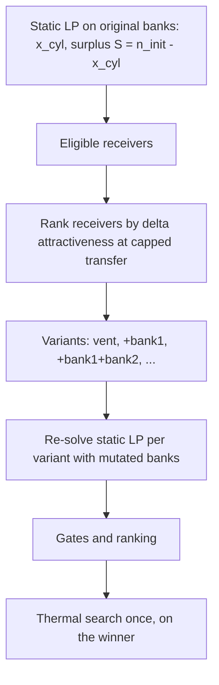

# Helium Salvage on Drain Design

Resolves GitHub issue #5.

## Status

Design approved by the user in conversation on 2026-10-27. The written spec awaits user review. Implementation has not started.

## Goal

When the Optimize recipe must drain the working tank, decide whether the surplus gas should be vented or moved into an existing non-pure bank, so helium (and oxygen) is not wasted. The decision weighs the gas value kept against the change in how attractive each affected bank's leftover mix is for future blending.

## Approved decisions

- **Receivers:** any enabled bank that is not a pure gas (not 100% O₂, not 100% He) and has a `maxPressureBar`. There is no scrap flag.
- **New bank field:** `maxPressureBar` (1–350 bar, at least the bank's current `pressureBar`). Existing banks without it migrate to 200 bar (the booster max-output default). The default Sample scrap bank ships with 200. The field is editable in Inventory.
- **Approach:** variant search with re-solve. Receiver and source may be the same bank; the planner models that case.
- **Transfer:** the working tank is the source. Decant until pressures equalize, then the booster (allowed) down to the booster minimum source pressure.
- **Prices:** independent constants `SALVAGE_HE_PRICE_PER_LITRE = 0.075` and `SALVAGE_O2_PRICE_PER_LITRE = 0.007` (virtual units per free-gas litre), defined in `js/salvage.js`. Salvage never reads Settings or the #3 cost data, so #3 stays display-only and unchanged.
- **Scope:** Optimize only. Compare and What-if rows are manual and unchanged. The summary tiles are unchanged, so screenshot baselines are not touched.
- **No global on/off setting.** The attractiveness gate protects banks.
- **Initial drain only.** A drain created by an interim-reading re-plan stays vent-only.

## Variant search

1. Run the static solver on the original banks at the ambient-settled target pressure. If it does not drain (`drainPressure` at floating-point roundoff), salvage is skipped.
2. Compute the capped transfer to each eligible receiver (see Transfer limits). Rank receivers by the delta in attractiveness of the receiving bank's state immediately after that transfer, best first; this ordering is a cheap heuristic only, and the gates below judge the post-recipe states. Variants are the vent baseline plus cascades of the first k receivers, for k = 1…N. This is N+1 static solves, not an exponential subset search.
3. For each variant, mutate copies of the receiving banks (moles added, composition, pressure under the selected gas model), re-run the static solver, and compute the final leftover state of every bank after the recipe's draws.
4. Apply, in order:
   1. **Feasible:** the re-solved surplus `S'` is at least the salvaged moles. Otherwise the variant is discarded.
   2. **Attractiveness gate:** for each bank, `score(final state in variant) − score(final state in baseline)` is at least −2.0.
   3. **Value gate:** net value kept is at least `SALVAGE_MIN_VALUE = 1.0` virtual unit. Net value kept is **post-recipe**: for every enabled bank, take its final He and O₂ free-gas litres after the recipe's draws (the same final states used for the attractiveness gate), price them with the fixed prices, sum across banks, and subtract the same sum for the vent baseline. Gas moved into a bank and then drawn by the recipe therefore counts only through the draws it displaces from other banks, never gross. The working tank's end state is identical in every variant (same target), so any change in how much the cylinder retains shows up as a change in bank stock.
   4. **Rank:** highest value kept, then highest Σ delta attractiveness, then lowest LP cost.
5. The winner (or the baseline if none qualifies) is passed to the existing thermal search unchanged. The thermal bisection (about 40 static solves) runs once, not per variant.

The retention coefficient is unchanged: the optimizer still prefers keeping gas in the cylinder over salvaging it. Salvage only decides what happens to gas the recipe has already chosen to remove.

## Attractiveness score

`js/leftover-attractiveness.js` exports a pure `leftoverAttractiveness({ oxygenPercent, heliumPercent, pressureBar, volumeL, maxPressureBar })` returning a score on a **0–100 scale**, defined as

`score = 100 · (0.4 · s_line + 0.4 · s_versatility + 0.2 · s_energy)`

where each term below lies in [0, 1], so the score is in [0, 100]. The −2.0 gate is therefore two points on this scale. It adapts the user's reference function with these corrections:

- **Line proximity:** `s_line = exp(-15 · d_perp)` with `d_perp = |3.077·f_O₂ + f_He − 1| / √(3.077² + 1)`. For the five standard targets the residual `|3.077·f_O₂ + f_He − 1|` is at most 0.02, so `d_perp` is at most about 0.006 and `s_line` is at least about 0.91.
- **Versatility:** for each standard target (21/35, 18/45, 15/55, 12/65, 10/70), the bank counts as reachable when it can be topped up to the target by adding gas only, within its max pressure. For gas fractions `f_x` and target fractions `t_x` (O₂, He, N₂), that is `P_bank · max_x(f_x / t_x) ≤ maxPressureBar` (components with `t_x = 0` need `f_x = 0`). The reference implementation checked only N₂, which wrongly scored pure O₂ as reaching every target.
- **Energy:** a helium-amount term, `min(1, heliumLitres / 1000)`, where `heliumLitres = bank free-gas litres × f_He` (free-gas litres use the same convention as `ventedGasLitres`). This replaces `(P/100)·f_He`, which ignored volume and exceeded 1 above 100 bar. The 1000 L reference is a named constant `SCORE_REFERENCE_HELIUM_LITRES`, so the default Sample scrap bank (12 L, 45 bar, 19/40) scores about 0.2 on this term.
- **Weights and thresholds:** 0.4 / 0.4 / 0.2 and the −2.0 gate are kept from the reference (the gate is "variant minus baseline" for the same bank's post-recipe state). A bank with invalid fractions (negative, or O₂ + He above 100%) scores 0. Tests pin the intended behavior, for example that dumping a 12/65 mix into a 21/35 scrap bank is refused.
- **`s_versatility`** is `reachableCount / 5`.

## Transfer limits

The amount moved into a bank is the minimum of:

1. The drain surplus, down to `retainedPressure` (the working tank is never emptied below what the recipe retains).
2. The bank's `maxPressureBar`; the booster stage is additionally capped at `maxBoosterOutputPressureBar`.
3. Physical limits: Decant to equalization, then booster down to `minimumSourcePressureBar` on the working tank. When the retained pressure is below that minimum, the rest is vented.

All quantities use moles and the selected gas model, not bar·L. Receivers cascade in rank order on the working tank's remaining surplus.

## Protocol and thermal model

- `drain` stays the vent step; its pressure drop is only the vented remainder. Salvage adds protocol steps of type `salvage` (stage `decant` or `boost`), each carrying `receiverBankId`, `receiverBankName`, `movedMoles`, `movedHeliumLitres`, and the receiving bank's before and after pressure and mix.
- A salvage step has no trajectory point (the working tank's mix is unchanged) and no interim-reading slot, like drain.
- `js/thermodynamics.js` models a salvage step as a drain-type, cooling step on the working tank. A decant stage uses the configured decant rate selected by the working tank mix; a boost stage uses the booster fill-rate model with the bank as receiver. The tank-side pressure rate follows from moles conservation. The bank's own temperature is not modeled (assumed at ambient).
- Helium vented is reduced by the helium moved into banks. The existing "Helium salvaged" tile keeps its present meaning (helium retained in the cylinder or supplied). Salvage details appear in the protocol cards only.

## Interim-reading re-plans

`js/plan-with-readings.js` applies the base plan's salvage to its working copy of banks before any re-plan, and calls the optimizer with salvage disabled. The result exposes `salvageTransfers` so both `main.js` and `interim-check.js` see the same banks.

## Files

- **Create:** `js/leftover-attractiveness.js`, `js/salvage.js` (price constants, transfer limits, receiver ranking, variant generation, selection).
- **Modify:** `js/optimizer.js` (wrapper that selects the variant before the thermal search), `js/thermodynamics.js` (salvage step type), `js/bank-storage.js` (field, migration, defaults), `js/input-validation.js` (bank validation), `js/ui/supply-banks.js` (field), `js/ui/results.js` (cards), `js/plan-with-readings.js`, `docs/optimizer.md`, `docs/architecture.md`, `docs/UI.md`.
- **Tests:** `tests/optimizer.test.js` and new `tests/leftover-attractiveness.test.js`, `tests/salvage.test.js`, plus extensions to the bank-storage, input-validation, results and plan-with-readings suites and a browser test for the Inventory field.

## Risks and checks

- **Solve count:** N+1 static solves before the thermal search. Measure the Optimize latency on the default inventory before and after.
- **Retention invariant:** the preservation regression in `docs/development.md` (12 L, 80 bar, 21/35 to 210 bar, 18/45) must still begin with retention, not a drain.
- **Booster rate on a reversed flow:** the fill-rate model is receiver-oriented; the first plan task verifies the tank-side pressure rate derived from it against a moles-conservation check.
- **Screenshot baselines:** unchanged by this design; read `docs/ci-reproduction.md` before touching any.
- **#3 interaction:** #3 prices operations by step type. When #3 is implemented, `salvage` steps need an operation mapping; this issue does not change #3.

## Out of scope

Booster-assisted transfers into banks from Compare/What-if; per-bank opt-out flags; salvage in re-plans; any display of money value; bank temperature modeling.
